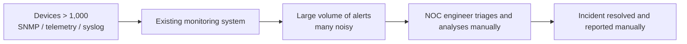
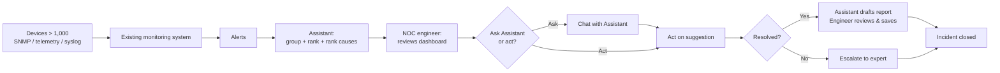

# Business Requirements Document (BRD) — GenAI Network Device Monitoring

> **Standard:** IEEE 29148-2018 · **Generated from:** `analysis/BRD_Prompt_IEEE_standard.md`
> **Status:** Draft v0.2 — populated from elicitation answers (SRC-001). Sponsor, dates, budget, baselines, targets and remaining context are **simulated** at the project owner's request (marked `[Simulated]` or recorded in Section 4.12).

---

## Validation Summary

**Inputs received**

| Input | Received? |
|---|---|
| Organization type | Yes — learning/research project (SRC-001) |
| Trigger | Yes — shortage of analysis skills/staff; excessive noisy alerts (SRC-001) |
| Scale | Yes — large, > 1,000 devices (SRC-001) |
| Desired outcomes | Yes — 4 outcomes (SRC-001) |
| Stakeholders | Partial — NOC / network operations engineers only |
| Constraints | Yes — no network data sent externally; data is simulated/public (SRC-001) |
| Data sources | Yes — SNMP/telemetry, syslog, existing monitoring system (SRC-001) |
| Sponsor, owner, timeline, budget | No |
| Baselines and targets | No — baselines do not exist yet |

**Top 3 risks to requirement quality**

1. **No baselines** — targets cannot be validated until current-state measures exist (RSK-001).
2. **Constraint tension** — "no external data" combined with GenAI limits the solution space; to be handled in design, not here (RSK-002).
3. **Single stakeholder group** — requirements reflect only NOC engineers; sponsor/evaluator needs are unknown (RSK-003).

---

## 4.1 Document control

| Field | Value |
|---|---|
| Title | Business Requirements Document — GenAI Network Device Monitoring |
| Document number | **[Simulated]** BRD-GNM-001 |
| Version | 0.2 |
| Status | Draft |
| Author | Nguyen Trieu Dieu Linh |
| Contributors / Reviewers / Approver | **[Simulated]** Contributor: Nguyen Trieu Dieu Linh; Reviewer: Le Thi Binh (NOC team lead); Approver: Tran Van An (project supervisor) |
| Confidentiality / Distribution | **[Simulated]** Internal. Distribution: project supervisor, NOC team lead, data-protection reviewer, project owner |

| Version | Date | Author | Change summary |
|---|---|---|---|
| 0.1 | 2026-10-19 | Nguyen Trieu Dieu Linh | Skeleton, no business inputs |
| 0.2 | 2026-10-19 | Nguyen Trieu Dieu Linh | Populated from elicitation answers (SRC-001) |

## Vision Statement

> **The Assistant ensures that any NOC engineer—regardless of experience—can navigate alert storms, diagnose incidents with confidence, and close them completely within minutes, all without exposing network data outside the organization's own infrastructure.**

This vision aligns the project with the organization's goal of building resilient, autonomous network operations that do not depend on a small group of experts and that maintain data sovereignty.

## 4.2 Executive summary

- **Problem:** The network contains more than 1,000 devices. Operations staff receive many noisy alerts, and finding the cause of an incident depends on scarce analysis skills (SRC-001). Quantified impact **[Simulated]**: about 25 high-severity incidents per month, each costing about 90 minutes of diagnosis, and roughly 120 engineer-hours per month spent on noisy alerts and manual reports.
- **Proposed business change:** Network operations gain automated assistance that reduces noisy alerts, speeds up identification of incident causes, lets less experienced engineers handle common incidents, and produces incident reports without manual writing.
- **Benefits and metrics:** MET-001 to MET-004 (Section 4.4); targets in Section 4.4 (simulated). Expected benefits **[Simulated]**: less alert fatigue, faster incident resolution, lower dependence on a few experts.
- **Investment, timeline, major risks:** Learning/research project (SRC-001); **[Simulated]** budget USD 500 (tools and compute), timeline 16 weeks, 2026-10-19 to 2027-02-12. Risks RSK-001 to RSK-003.
- **Decision requested:** Approve the business objectives and scope as the baseline for the PRD **[Simulated]**.

## 4.3 Business context and problem statement

**Current state (from SRC-001; detailed steps simulated, OQ-009)**

1. A device emits SNMP/telemetry or syslog.
2. The existing monitoring system raises an alert on fixed thresholds.
3. The NOC engineer reviews the alert queue and discards noise.
4. The engineer searches logs and metrics manually to find the cause; complex cases are escalated to an expert.
5. The engineer resolves the incident and writes a report by hand.

**Proposed state (To-Be workflow)**

1. Devices emit SNMP/telemetry and syslog (unchanged).
2. The existing monitoring system raises alerts (unchanged).
3. **The Assistant groups related alerts into incidents and suppresses noise.**
4. The NOC engineer opens the dashboard and sees ranked incidents with probable causes and evidence.
5. **The engineer follows the suggested action or asks the Assistant in chat; the Assistant provides plain-language guidance.**
6. The engineer confirms the incident resolved; **the Assistant drafts a report ready for review.**

**Operational scenarios (examples; to be detailed in PRD and design)**
- **Alert storm from one link failure:** 50 alerts arrive from a failed link and dependent services. The Assistant groups them as one Critical incident, shows the link-failure root cause with evidence, and recommends "check interface status and bring link online". A junior engineer follows the recommendation and resolves the incident in 10 minutes without waiting for an expert.
- **Configuration error during change window:** A routing flap generates repeated alerts and a configuration mismatch alert. The Assistant identifies a configuration error as the likely cause, shows the affected config lines, and suggests "compare running and startup configs; re-apply the intended config". The engineer confirms and resolves.
- **Hardware fault with cascading alerts:** A faulty memory module triggers device overload, loss of redundancy, and a hardware alarm. The Assistant ranks the hardware fault as top cause, recommends "schedule replacement and monitor for redundancy restoration", and the engineer escalates to the hardware team. The Assistant drafts a report documenting the timeline and the escalation decision.

- **Who is affected:** NOC / network operations engineers (STK-001) (SRC-001); sponsor and evaluators for evidence; data-protection reviewer for data handling.
- **Cost of inaction** **[Simulated]:** about 120 engineer-hours per month lost, longer outages, and continued dependence on a few experts.
- **Root causes (stated):** shortage of analysis staff/skills; noisy alerting (SRC-001). Deeper causes **[Simulated]:** fixed-threshold alert rules that ignore context, no correlation across devices, and diagnostic knowledge held by individuals rather than recorded.
- **Why now:** Learning/research initiative with a fixed delivery window (CON-003).

## 4.4 Business drivers and objectives

| ID | Business driver | Objective (outcome) | Metric ID | Baseline | Target | Timeframe | Source |
|---|---|---|---|---|---|---|---|
| BO-001 | Noisy alerts | Reduce the number of alerts engineers must act on | MET-001 | 800 per engineer per day **[Simulated]** | ≤ 320 (−60%) | By 2027-02-12 | SRC-001 |
| BO-002 | Slow root-cause analysis | Shorten the time to identify the cause of an incident | MET-002 | 90 minutes **[Simulated]** | ≤ 45 minutes (−50%) | By 2027-02-12 | SRC-001 |
| BO-003 | Dependence on few experts | Enable less experienced engineers to resolve common incidents without expert help | MET-003 | 30% **[Simulated]** | ≥ 60% | By 2027-02-12 | SRC-001 |
| BO-004 | Manual incident reporting | Reduce the effort needed to produce an incident report | MET-004 | 40 minutes **[Simulated]** | ≤ 12 minutes (−70%) | By 2027-02-12 | SRC-001 |

**Metric definitions** (baseline and target values are simulated, see OQ-010)

| ID | Definition | Formula (proposed) | Data source | Owner | Frequency | Baseline date |
|---|---|---|---|---|---|---|
| MET-001 | Actionable alerts per engineer per day | Alerts requiring engineer action ÷ engineer-days | Existing monitoring system | NOC team lead | Weekly | 2026-11-02 |
| MET-002 | Mean time to identify root cause | Mean (cause identified − incident detected) | Incident records | NOC team lead | Weekly | 2026-11-02 |
| MET-003 | Share of common incidents resolved without escalation | Incidents closed at first level ÷ common incidents | Incident records | NOC team lead | Weekly | 2026-11-02 |
| MET-004 | Engineer time per incident report | Mean minutes spent writing a report | Time sample | NOC team lead | Weekly | 2026-11-02 |

## 4.5 Scope

- **In scope:** Monitoring of network devices (> 1,000) using SNMP/telemetry and syslog data and the existing monitoring system (SRC-001); alert noise reduction, root-cause assistance, support for less experienced engineers, incident reporting. Device types and sites **[Simulated]**: routers, switches and firewalls across 10 sites; incident types: link failure, device overload, configuration error, routing flap, hardware fault.
- **Out of scope:** Real production network data and its transfer outside the organization (CON-001, CON-002). **[Simulated]** Also excluded: wireless access points, automatic remediation of devices, replacement of the existing monitoring system.
- **Deferred:** **[Simulated]** Automatic remediation, wireless devices, integration with a real ticketing system.
- **Boundaries:** Existing monitoring system remains the source of alerts; replacing it is not a goal **[Simulated]** (OQ-012).

## 4.6 Stakeholders and needs

| ID | Stakeholder / group | Role in the business | Interest | Influence | Needs | Source |
|---|---|---|---|---|---|---|
| STK-001a | NOC / network operations engineers — junior (1–3 years) | Monitor alerts, resolve common incidents | Faster diagnosis without expert help; clear guidance | Medium | SN-001, SN-003 | SRC-001 |
| STK-001b | NOC / network operations engineers — senior (6+ years) | Handle complex incidents, review junior work | Spend time on hard incidents, not triage or routine reports | Medium | SN-002, SN-004 | SRC-001 |
| STK-001c | NOC team lead | Manage team, track SLA and metrics | Alert load and resolution time metrics; junior team capability | High | SN-001, SN-005 | SRC-001 |
| STK-002 | Sponsor / evaluator of the learning project **[Simulated]** | Approves scope and evaluates results | Measurable results within time and budget | High | SN-005 | Simulated |
| STK-003 | Data-protection reviewer **[Simulated]** | Checks data handling | Network data stays in the permitted boundary; audit trail | High | SN-006 | Simulated |

| ID | Stakeholder | Need statement | Current pain | Evidence | Priority |
|---|---|---|---|---|---|
| SN-001 | STK-001a, STK-001b | I need to see only alerts that matter | Too many noisy alerts obscure real incidents | SRC-001 | Must |
| SN-002 | STK-001a, STK-001b | I need to find the cause of an incident quickly | Manual analysis is slow; complex cases escalate to experts | SRC-001 | Must |
| SN-003 | STK-001a | I need to resolve common incidents without waiting for an expert | Junior engineers lack the experience to diagnose alone | SRC-001 | Must |
| SN-004 | STK-001b, STK-001c | I need incident reports produced without manual writing | Reporting after every incident costs 30–40 minutes per incident | SRC-001 | Should |
| SN-005 | STK-001c, STK-002 | I need to see alert load and resolution-time metrics to track SLA and team capability | No current visibility into work volume or diagnosis speed | SRC-001, Simulated | Must |
| SN-006 | STK-003 | I need assurance that no network data leaves the permitted boundary and a complete audit trail | Data leakage risk; compliance requirement | Simulated | Must |

Adoption blockers **[Simulated]**: NOC engineers who distrust automated suggestions, and the data-protection reviewer if CON-001 cannot be demonstrated. Priorities reflect the order given in SRC-001 and need confirmation.

## 4.7 Business requirements

Quantities use simulated baselines and targets (OQ-010) and must be re-confirmed after real measurement.

### Alert noise reduction

| ID | Requirement | Rationale | Source | Priority | Acceptance criteria | Verification | Status |
|---|---|---|---|---|---|---|---|
| BR-001 | The organization **shall** reduce the number of alerts requiring engineer action by at least 60% (from 800 to no more than 320 per engineer per day) against the MET-001 baseline. | Alert noise burdens engineers | BO-001 / SN-001 | Must | AC-001 | Analysis | Draft |
| BR-002 | When several alerts arise from one underlying event, the organization **shall** present them to engineers as a single incident. | Duplicate alerts add noise | BO-001 / SN-001 | Must | AC-002 | Test | Draft |
| BR-003 | The organization **shall** retain access to every suppressed alert for 30 days. | Avoid losing genuine alerts | BO-001 / SN-001 | Should | AC-003 | Inspection | Draft |

### Root-cause analysis

| ID | Requirement | Rationale | Source | Priority | Acceptance criteria | Verification | Status |
|---|---|---|---|---|---|---|---|
| BR-004 | The organization **shall** reduce the mean time to identify root cause by at least 50% (from 90 to no more than 45 minutes) against the MET-002 baseline. | Slow diagnosis prolongs incidents | BO-002 / SN-002 | Must | AC-004 | Analysis | Draft |
| BR-005 | For each incident, the organization **shall** provide engineers with a ranked list of probable causes with the supporting evidence for each. | Engineers must be able to verify a suggestion | BO-002 / SN-002 | Must | AC-005 | Demonstration | Draft |

### Support for less experienced engineers

| ID | Requirement | Rationale | Source | Priority | Acceptance criteria | Verification | Status |
|---|---|---|---|---|---|---|---|
| BR-006 | The organization **shall** enable engineers without expert-level analysis skills to resolve at least 60% of common incidents (MET-003; baseline 30%) without escalation. | Reduces expert dependence | BO-003 / SN-003 | Must | AC-006 | Test | Draft |
| BR-007 | For each incident, the organization **shall** give engineers a recommended next action in plain language. | Guides junior engineers | BO-003 / SN-003 | Should | AC-007 | Demonstration | Draft |

### Incident reporting

| ID | Requirement | Rationale | Source | Priority | Acceptance criteria | Verification | Status |
|---|---|---|---|---|---|---|---|
| BR-008 | When an incident is closed, the organization **shall** produce an incident report summarizing the timeline, cause and actions taken. | Removes manual reporting | BO-004 / SN-004 | Should | AC-008 | Demonstration | Draft |
| BR-009 | The organization **shall** reduce engineer time per incident report by at least 70% (from 40 to no more than 12 minutes) against the MET-004 baseline. | Quantifies BO-004 | BO-004 / SN-004 | Should | AC-009 | Analysis | Draft |

### Data protection and auditability

| ID | Requirement | Rationale | Source | Priority | Acceptance criteria | Verification | Status |
|---|---|---|---|---|---|---|---|
| BR-010 | The organization **shall** keep all network device data within the boundary defined in CON-001. | Stated constraint; data sovereignty | CON-001 / SN-006 | Must | AC-010 | Inspection | Draft |
| BR-012 | The organization **shall** maintain an audit log of every root-cause suggestion, engineer feedback, and incident closure decision that can be reviewed by the data-protection reviewer and sponsor. | Regulatory best practice; enable accountability | SN-006 | Should | AC-012 | Inspection | Draft |
| BR-013 | The organization **shall** define and document who may access incident data (NOC engineers may view their own incidents and team incidents; team lead may view all NOC incidents; data-protection reviewer may access audit logs; sponsor may view aggregated metrics only). | Enable controlled access; protect sensitive analysis | SN-006 | Should | AC-013 | Inspection | Draft |
| BR-011 | At the end of the project, the organization **shall** report MET-001 to MET-004 against their baselines, measured on the dataset in Appendix 4.15. | Sponsor needs evidence of results | BO-001 to BO-004 / SN-005 | Must | AC-011 | Review | Draft |

### System availability and resilience

| ID | Requirement | Rationale | Source | Priority | Acceptance criteria | Verification | Status |
|---|---|---|---|---|---|---|---|
| BR-014 | If the Assistant becomes unavailable, NOC engineers **shall** continue to use the existing monitoring system unchanged without service interruption. | Avoid creating a single point of failure; existing system is the ground truth | SN-001, SN-002 | Must | AC-014 | Demonstration | Draft |
| BR-015 | The organization **shall** recover the Assistant and resume service within 4 hours of a failure, without losing closed incidents, reports or audit logs. | Limit impact on incident response; protect data integrity | SN-002, SN-005 | Should | AC-015 | Demonstration | Draft |

### Acceptance criteria

| ID | Criterion |
|---|---|
| AC-001 | Over 30 days of simulated data, MET-001 is at most 320 per engineer per day (at least 60% below the 800 baseline). |
| AC-002 | In a test set with known event groupings, at least 90% of related alerts are presented as one incident. |
| AC-003 | A reviewer retrieves any suppressed alert from the last 30 days. |
| AC-004 | Over the evaluation set, MET-002 is at most 45 minutes (at least 50% below the 90-minute baseline). |
| AC-005 | For 50 seeded incidents, the true cause appears within the top 3 ranked causes in at least 80% of cases, each with cited evidence. |
| AC-006 | In a trial, engineers resolve at least 60% of common seeded incidents without escalation. |
| AC-007 | Every incident in the evaluation set shows a next action that an NOC reviewer rates as understandable. |
| AC-008 | Each closed incident in the evaluation set has a report containing timeline, cause and actions, confirmed by a reviewer. |
| AC-009 | MET-004 is at most 12 minutes (at least 70% below the 40-minute baseline). |
| AC-010 | A review shows no network device data leaves the CON-001 boundary. |
| AC-011 | A results report states baseline, measured value and pass/fail for each of MET-001 to MET-004, and the sponsor accepts it. |
| AC-012 | An audit log exists recording every suggestion, feedback, and closure; spot-check of 50 entries confirmed accurate and retrievable by authorized reviewer. |
| AC-013 | Role-based access is implemented and verified: NOC engineers access only their team's incidents, team lead accesses all NOC incidents, data-protection reviewer accesses audit logs only, sponsor accesses metrics report only. |
| AC-014 | During a 4-hour outage of the Assistant, NOC engineers successfully access and triage alerts through the existing monitoring system unchanged. |
| AC-015 | After simulated failure and 4-hour recovery, all closed incidents, reports and audit logs are intact and accessible. |

## 4.8 Business rules

| ID | Rule | Type | Scope | Enforcement owner | Source |
|---|---|---|---|---|---|
| BRU-001 | **[Simulated]** An alert is Critical if it affects service for a whole site, Major if it affects one device with redundancy lost, Minor otherwise | Policy | Alert handling | NOC team lead | Simulated |
| BRU-002 | **[Simulated]** A Critical incident not resolved within 60 minutes is escalated to an expert | Policy | Escalation | NOC team lead | Simulated |
| BRU-003 | **[Simulated]** An incident is closed only after the engineer confirms service is restored | Decision | Incident closure | NOC team lead | Simulated |

## 4.9 Constraints

| ID | Constraint | Type | Imposed by | Impact | Source |
|---|---|---|---|---|---|
| CON-001 | Network data shall not leave the project owner's own computing environment (local machines or institution-controlled lab); no third-party cloud GenAI service may receive it **[Simulated]** | Organizational / Data Sovereignty | Project supervisor **[Simulated]** | Limits where analysis may run; model must be open-source and locally hosted | SRC-001 |
| CON-002 | Only simulated or publicly available data is used for evaluation; no production network data | Organizational / Data Protection | Project | No production data for validation; metrics are measured on simulated data; real network isolation from testing | SRC-001 |
| CON-003 | **[Simulated]** Delivery within 16 weeks (by 2027-02-12) and a budget of USD 500 | Time / Budget | Project supervisor | Limits scope, hardware, and compute available | Simulated (OQ-007) |
| CON-004 | **[Assumed from institutional context]** No applicable external regulatory requirements (e.g., GDPR, HIPAA, PCI-DSS) for this learning/research project on simulated data | Compliance | Institution | If institution later uses production data, CON-004 must be re-assessed and additional regulatory requirements added | Simulated |

## 4.10 Assumptions, dependencies, and risks

| ID | Item | Type | Description | Impact if false | Owner | Validation / mitigation | Due |
|---|---|---|---|---|---|---|---|
| ASM-001 | Simulated data represents real alert noise and incident patterns | Assumption | Results on simulated data will transfer to real networks | Reported benefits may not hold | Project owner | Document realism of dataset (Appendix 4.15) | 2026-11-30 |
| ASM-002 | The existing monitoring system exposes alerts, SNMP/telemetry and syslog data | Assumption | Data is accessible to the initiative | Objectives cannot be measured | Project owner | Confirm with data owner (OQ-012) | 2026-11-09 |
| DEP-001 | Access to simulated/public datasets | Dependency | Datasets of > 1,000 devices or equivalent | No evaluation possible | Project owner | Dataset defined in Appendix 4.15; check realism before use | 2026-11-16 |
| RSK-001 | No baselines | Risk | Baselines are simulated, not measured → targets may be unrealistic → success claims unreliable | High | Project owner | Re-measure baselines on the simulated dataset before reporting results | 2026-11-16 |
| RSK-002 | Constraint tension | Risk | CON-001 limits solution options → possible capability or cost limits | Medium | Project owner | Resolve in PRD/SAD | 2026-12-14 |
| RSK-003 | Single stakeholder group | Risk | Sponsor/evaluator needs are simulated → rework if real needs differ | Medium | Project owner | Confirm with the real sponsor | 2026-11-09 |

## 4.11 Traceability

| Business objective | Stakeholder need | Business requirement | Acceptance criteria | Downstream PRD/SRS ID |
|---|---|---|---|---|
| BO-001 | SN-001 | BR-001 | AC-001 | [TBD] |
| BO-001 | SN-001 | BR-002 | AC-002 | [TBD] |
| BO-001 | SN-001 | BR-003 | AC-003 | [TBD] |
| BO-002 | SN-002 | BR-004 | AC-004 | [TBD] |
| BO-002 | SN-002 | BR-005 | AC-005 | [TBD] |
| BO-003 | SN-003 | BR-006 | AC-006 | [TBD] |
| BO-003 | SN-003 | BR-007 | AC-007 | [TBD] |
| BO-004 | SN-004 | BR-008 | AC-008 | [TBD] |
| BO-004 | SN-004 | BR-009 | AC-009 | [TBD] |
| CON-001 | SN-006 | BR-010 | AC-010 | [TBD] |
| CON-001 | SN-006 | BR-012 | AC-012 | [TBD] |
| CON-001 | SN-006 | BR-013 | AC-013 | [TBD] |
| SN-001, SN-002 | SN-001, SN-002 | BR-014 | AC-014 | [TBD] |
| SN-002, SN-005 | SN-002, SN-005 | BR-015 | AC-015 | [TBD] |
| BO-001 to BO-004 | SN-005 | BR-011 | AC-011 | [TBD] |

**Coverage**

- Objectives with no requirements: none.
- Orphan requirements: none (BR-010 traces to constraint CON-001).
- Needs with no requirement: none.
- Requirements lacking acceptance criterion or verification method: none; thresholds are simulated (OQ-010).

## 4.12 Open questions and decisions

| ID | Question / decision needed | Why it matters | Owner | Needed by | Status | Resolution |
|---|---|---|---|---|---|---|
| OQ-001 | Document number, confidentiality class, distribution? | Document control | Project owner | 2026-10-19 | Closed (simulated) | Set in Section 4.1 |
| OQ-002 | Who are the sponsor, business owner, reviewers, approver? | Approval | Project owner | 2026-10-19 | Closed (simulated) | Simulated names assigned 2026-10-19 by project owner's instruction; replace with real people if any |
| OQ-004 | What is the quantified impact of the current problem (incidents, downtime, hours)? | Cost of inaction | Project owner | 2026-10-19 | Closed (simulated) | Section 4.2 and 4.3 |
| OQ-005 | What are the deeper root causes beyond staff shortage and alert noise? | Objectives | Project owner | 2026-10-19 | Closed (simulated) | Section 4.3 |
| OQ-006 | What benefits does the sponsor expect? | Success definition | Project owner | 2026-10-19 | Closed (simulated) | Section 4.2 |
| OQ-007 | Timeline, deadlines and budget? | CON-003, feasibility | Project owner | 2026-10-19 | Closed (simulated) | 16 weeks, USD 500, simulated 2026-10-19 by project owner's instruction |
| OQ-008 | What decision is requested from the approver? | Executive summary | Project owner | 2026-10-19 | Closed (simulated) | Section 4.2 |
| OQ-009 | What are the exact current-state steps from alert to report? | Section 4.3 | Project owner | 2026-10-19 | Closed (simulated) | Five steps in Section 4.3 |
| OQ-010 | What are baselines and targets for MET-001 to MET-004, and thresholds in BR/AC? | BO-001–004, all BR | Project owner | 2026-10-19 | Closed (simulated) | Simulated values set 2026-10-19 at project owner's request: see Section 4.4 and AC-001 to AC-009. Replace after real measurement. |
| OQ-011 | Which device types, sites and incident types are in scope, deferred or excluded? | Scope | Project owner | 2026-10-19 | Closed (simulated) | Section 4.5 |
| OQ-012 | Is the existing monitoring system retained, and what data does it expose? | Boundaries, ASM-002 | Project owner | 2026-10-19 | Closed (simulated) | Retained; exposes alerts, SNMP/telemetry and syslog (ASM-002, still to be confirmed) |
| OQ-013 | Who else is a stakeholder (sponsor/evaluator, security), and who may block adoption? | RSK-003 | Project owner | 2026-10-19 | Closed (simulated) | STK-002, STK-003; blockers in Section 4.6 |
| OQ-014 | How long must suppressed alerts remain retrievable? | BR-003 | Project owner | 2026-10-19 | Closed (simulated) | 30 days |
| OQ-015 | Which business rules govern severity, escalation and closure? | BRU-001 | Project owner | 2026-10-19 | Closed (simulated) | BRU-001 to BRU-003 |
| OQ-016 | What exactly is the "outside" boundary and who imposes it? | CON-001, BR-010 | Project owner | 2026-10-19 | Closed (simulated) | Boundary = project owner's own computing environment; no third-party cloud GenAI. Simulated 2026-10-19. |
| OQ-017 | Which simulated or public datasets will be used, and how realistic are they? | CON-002, ASM-001, DEP-001 | Project owner | 2026-10-19 | Closed (simulated) | Synthetic dataset described in Appendix 4.15. Simulated 2026-10-19. |

*(OQ-003 was merged into OQ-001; ID retained as Withdrawn.)*

## 4.13 Glossary and references

| Term | Definition |
|---|---|
| BRD | Business Requirements Document |
| GenAI | Generative artificial intelligence |
| NOC | Network Operations Center |
| SNMP | Simple Network Management Protocol |
| Syslog | Standard protocol/format for device event logs |
| Telemetry | Streamed device performance data |
| Noisy alert | An alert that requires no engineer action (in the simulated dataset: an alert not linked to any seeded incident) |
| Common incident | An incident type that engineers resolve routinely (link failure, device overload, configuration error, routing flap, hardware fault — simulated) |
| Root cause | The underlying event that originated an incident |

| Source ID | Source | Type | Owner | Date | Evidences |
|---|---|---|---|---|---|
| SRC-001 | Elicitation answers given in conversation | Interview | Project owner | 2026-10-19 | Trigger, scale, outcomes, constraints, data sources |
| SRC-002 | IEEE 29148-2018 | Standard | IEEE | 2018 | Requirement quality rules |

## 4.14 Approval

| Role | Name | Decision | Signature / date |
|---|---|---|---|
| Executive sponsor | **[Simulated]** Tran Van An (project supervisor) | — | — |
| Business owner | **[Simulated]** Le Thi Binh (NOC team lead) | — | — |
| Product manager / product owner | Nguyen Trieu Dieu Linh | — | — |
| Compliance / legal | **[Simulated]** Pham Quoc Cuong (data-protection reviewer) | — | — |

Conditions of approval and baseline version: to be stated at review.

## 4.15 Appendix

### A. Simulated evaluation dataset (answers OQ-017) **[Simulated]**

| Item | Description |
|---|---|
| Devices | 1,200 synthetic devices (routers, switches, firewalls) across 10 sites |
| Duration | 30 days |
| Data types | SNMP/telemetry metrics, syslog events, alerts from an existing-monitoring-style rule set |
| Alert noise | About 800 actionable-looking alerts per engineer per day, matching the MET-001 baseline |
| Labelled incidents | 50 seeded incidents with known root cause, of which about 30 are common types |
| Origin | Generated by a script or network simulator, optionally mixed with publicly available syslog samples |
| Limitation | Realism against a production network is unproven (ASM-001) |

### B. Simulated baseline note

All MET-001 to MET-004 baselines were set by assumption, not measured. They must be re-measured on the dataset above before any result is reported.

---

## Verification checklist result (Section 5)

| Check | Result |
|---|---|
| Requirement quality (5.1) | Partial — `shall` syntax, singular, solution-free; quantities are simulated (OQ-010) |
| Completeness and traceability (5.2) | Partial — all objectives and needs covered; open questions lack owners and dates |
| Business validation (5.3) | **Partial** — baselines are simulated, not measured; sponsor has not confirmed the problem statement |

## Readiness statement

**Ready with conditions.**

No open questions remain, but every answer is simulated. Conditions: (1) simulated baselines, targets, boundary, dataset, business context, rules and stakeholders (all closed OQs) are confirmed or replaced by real values; (2) risk RSK-001 is accepted by the sponsor. Sponsor, approvers, budget and timeline are simulated (OQ-002, OQ-007) and must be replaced if the project becomes real.
