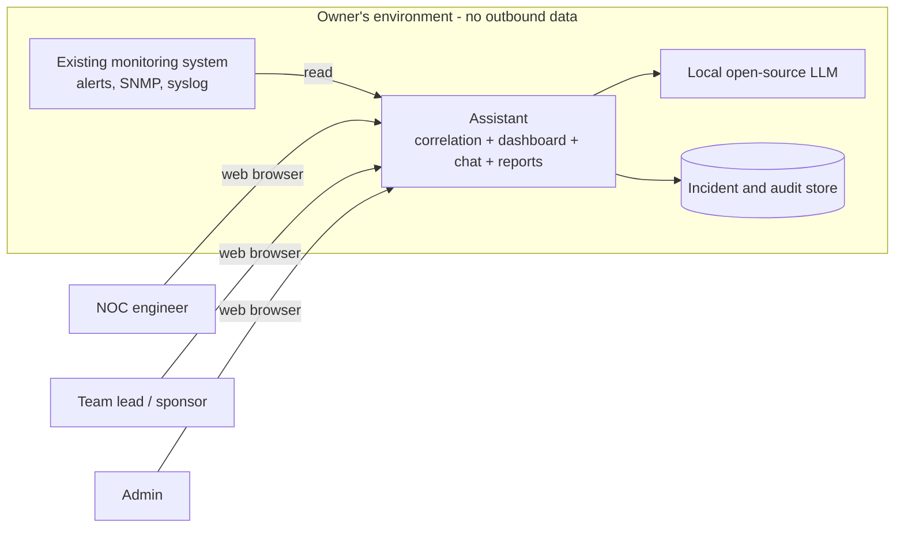
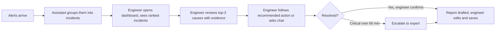

# Product Requirements Document (PRD) — GenAI Network Device Monitoring Assistant

> **Standard:** IEEE 29148-2018 · **Version:** 0.1 · **Status:** Draft
> **Built from:** `docs/requirements/BRD.md` (v0.2), `analysis/PRD_Prompt_IEEE_standard.md`, `analysis/PRD_prompt.md`, `analysis/PRD_Prompt_with_template.md`
> **Language:** English. **Simulated data:** the BRD's baselines, targets, names and dataset are simulated. Items marked **[Assumed]** are new PRD-level values chosen here and need confirmation.

---

## 0. Validation of Product Pillars

| Pillar | Source | Check |
|---|---|---|
| Product: assistant that groups alerts, suggests causes, guides engineers, writes reports | BO-001 to BO-004 | Consistent with the four BRD objectives |
| Target user: NOC / network operations engineers (STK-001) | BRD 4.6 | Valid; sponsor (STK-002) and data-protection reviewer (STK-003) are secondary |
| Problem: noisy alerts and scarce analysis skills across > 1,000 devices | BRD 4.3 | Valid; impact figures are simulated |
| Core solution: local GenAI model plus alert correlation, shown in a web dashboard with chat | User decision 2026-10-20 | Chosen; fits CON-001 only if the model runs locally |
| UX pillars: **evidence-first** (every suggestion shows its evidence), **low-noise** (few items, ranked by severity), **local-only** (no outbound data), **plain language** for junior engineers | BR-005, BR-007, BR-010 | Derived from BRD requirements |

**Top risks to PRD quality:** (1) all baselines are simulated, so targets are unproven (RSK-001); (2) a local model may be weaker than a cloud model and miss the 80 % top-3 target (RSK-002); (3) user personas are written from the BRD, not from interviews (RSK-003).

---

## 1. Introduction

### 1.1 Purpose
This PRD defines what the GenAI Network Device Monitoring Assistant ("the Assistant") shall do so that design, development and testing can proceed, and so every requirement traces back to a BRD objective.

### 1.2 Document scope
Covers functional, non-functional, interface and design-constraint requirements, UX/UI, verification, acceptance and release criteria.
**Out of scope:** architecture and implementation detail (SAD), project plan, automatic remediation of devices, wireless devices, replacement of the existing monitoring system (BRD 4.5).

### 1.3 Intended audience

| Audience | Use | Sections |
|---|---|---|
| Product owner / sponsor | Validate scope and outcomes | 0–4, 11 |
| Engineering / architecture | Design and build | 5–8 |
| UX | Design screens | 2.2, 6.2 |
| QA | Write tests | 5, 9, 10, 11 |
| Data-protection reviewer | Check data handling | 7, 8 |

### 1.4 Conventions
`REQ-xxx` system requirement · `S-xxx` stakeholder · `P-xxx` persona · `OBJ-xxx` objective (= BRD `BO-xxx`) · Priority: **MO** must (P0), **SH** should (P1), **CO** could (P2), **WN** will not have. Normative verb **shall**.

### 1.5 Definitions

| Term | Definition |
|---|---|
| Assistant | The product described in this PRD |
| Incident | A group of alerts judged to come from one underlying event |
| Noisy alert | Alert not linked to any real incident (BRD glossary) |
| Common incident | Link failure, device overload, configuration error, routing flap, hardware fault |
| NOC | Network Operations Center |
| SNMP / Syslog / Telemetry | Device metrics and event-log sources |
| LLM | Large language model |
| RCA | Root-cause analysis |
| RBAC | Role-based access control |
| MET-001 to MET-004 | BRD success metrics (see 1.7) |

### 1.6 References

| Document | Version | Location |
|---|---|---|
| BRD | 0.2 | `docs/requirements/BRD.md` |
| BRD checklist | — | `docs/requirements/BRD_IEEE_29148_Checklist.xlsx` |
| IEEE 29148-2018 | 2018 | IEEE |

### 1.7 Product vision and OKRs

**Vision.** Any NOC engineer, whatever their experience, can see which alerts matter, understand why an incident happened, and close it with a complete report in minutes, without sending network data outside their own environment.

| OKR | Objective | Key result (simulated baseline → target) | BRD link |
|---|---|---|---|
| OKR-1 | Cut alert noise | MET-001: 800 → ≤ 320 actionable alerts per engineer per day | BO-001 |
| OKR-2 | Faster diagnosis | MET-002: 90 → ≤ 45 minutes to identify root cause | BO-002 |
| OKR-3 | Less expert dependence and reporting effort | MET-003: 30 % → ≥ 60 % common incidents resolved without escalation; MET-004: 40 → ≤ 12 minutes per report | BO-003, BO-004 |

Deadline for all key results: 2027-02-12 (CON-003).

---

## 2. Project Scope and Context

### 2.1 System overview
The Assistant reads alerts, metrics and logs from the existing monitoring system, groups related alerts into incidents, proposes ranked probable causes with evidence, recommends a next action in plain language, answers questions in chat, and drafts an incident report when an incident closes. All processing runs inside the owner's environment using a locally hosted open-source language model (user decision 2026-10-20).

**Key capabilities:** alert correlation · root-cause suggestion · guided next action · incident chat · automatic report · audit and access control · results measurement.

**Value proposition:** engineers handle fewer, better-explained items; juniors resolve common incidents without waiting for experts; the sponsor receives measured results.

**Operating environment (assumed):**
- **Host hardware:** One server or workstation within the owner's institution with minimum 16 GB RAM, 100 GB free storage, and GPU if available (to be confirmed in SAD, OQ-P02).
- **Operating system:** Linux (Ubuntu 20.04 LTS or equivalent) or Windows Server 2019+.
- **Browser:** Chrome/Edge/Firefox (latest two versions); no mobile-specific requirements.
- **Network:** Isolated from external internet or restricted egress only to institution-approved sources; no cloud API calls.
- **Local model:** Open-source model (e.g., Mistral, Llama, or equivalent) running on the host; no third-party API keys.

### 2.2 System context

### 2.3 Product perspective and user journey

Journey steps: (1) discover incidents on the dashboard; (2) understand cause; (3) act; (4) confirm closure; (5) review and save report.

---

## 3. Stakeholder Needs and Personas

### 3.1 Stakeholders

| ID | Stakeholder | Need | BRD ref | Priority |
|---|---|---|---|---|
| S-001 | NOC engineers | See only alerts that matter; find cause fast; resolve common incidents alone; no manual report writing | STK-001, SN-001 to SN-004 | High |
| S-002 | Sponsor / evaluator | Evidence that targets are met | STK-002, SN-005 | High |
| S-003 | Data-protection reviewer | Proof that no data leaves the environment | STK-003, SN-006 | High |

### 3.2 Business objectives

| ID | Objective | Metric | Target | Timeframe |
|---|---|---|---|---|
| OBJ-001 (BO-001) | Reduce actionable alerts | MET-001 | ≤ 320 / engineer / day | 2027-02-12 |
| OBJ-002 (BO-002) | Shorten root-cause time | MET-002 | ≤ 45 min | 2027-02-12 |
| OBJ-003 (BO-003) | Reduce expert dependence | MET-003 | ≥ 60 % | 2027-02-12 |
| OBJ-004 (BO-004) | Cut reporting effort | MET-004 | ≤ 12 min | 2027-02-12 |

### 3.3 Personas **[Assumed]** (BRD checklist item "User Personas" was In Progress; these close it, pending interviews)

| ID | Persona | Role | Experience | Goals | Pain points | Tech proficiency | Context |
|---|---|---|---|---|---|---|---|
| P-001 | Minh (primary) | Junior NOC engineer | 1–2 years; basic network knowledge | Resolve common incidents without escalating; build confidence | Cannot tell real alerts from noise; unsure of root cause; fears breaking something | Medium | Works 8–16 shifts per month; handles Level 1 triage |
| P-002 | Hoa (primary) | Senior NOC engineer | 6+ years; expert in routing, MPLS, BGP | Spend time on hard incidents, not triage or routine reports | Interrupted by junior escalations; reports take 40 min each; bottleneck for team | High | On-call 3 weeks per year; mentors juniors |
| P-003 | Binh (secondary) | NOC team lead | 4–5 years; former senior engineer | Meet SLA (95% incidents resolved in 4 hours), track metrics, plan staffing | No visibility into alert load or diagnosis time; high variance in incident resolution | High | Strategic role; reports to Network Director |
| P-004 | Cuong (secondary) | Data-protection reviewer | Security/compliance background | Confirm data stays local; audit trail exists; access controls work | Cannot inspect AI data flows; worried about unintended leakage | Medium | Part-time role; reviews systems quarterly |

### 3.4 Constraints on needs
Regulatory: none identified for the simulated dataset **[Assumed]**; privacy is addressed through CON-001 (REQ-014).

---

## 4. Business / User Requirements (from BRD)

| BRD ID | Requirement summary | Priority |
|---|---|---|
| BR-001 | Reduce actionable alerts ≥ 60 % | MO |
| BR-002 | Present related alerts as one incident | MO |
| BR-003 | Keep suppressed alerts retrievable 30 days | SH |
| BR-004 | Reduce time to identify root cause ≥ 50 % | MO |
| BR-005 | Provide ranked probable causes with evidence | MO |
| BR-006 | Enable ≥ 60 % of common incidents resolved without escalation | MO |
| BR-007 | Give a plain-language next action | SH |
| BR-008 | Produce incident report on closure | SH |
| BR-009 | Reduce report time ≥ 70 % | SH |
| BR-010 | Keep data inside the permitted boundary | MO |
| BR-011 | Report MET-001 to MET-004 against baselines | MO |

---

## 5. System Requirements and User Stories

Each story uses *As a [persona], I want …, so that …*. Given-When-Then (GWT) criteria are given for all P0 stories.

### 5.1 Epic A — Alert correlation

| ID | Requirement | Pri | Source |
|---|---|---|---|
| REQ-001 | The Assistant shall read alerts, metrics and syslog events from the existing monitoring system. | MO | BR-001 |
| REQ-002 | When several alerts arise from one underlying event, the Assistant shall group them into one incident. | MO | BR-002 |
| REQ-003 | The Assistant shall keep every grouped or suppressed alert retrievable for 30 days. | SH | BR-003 |
| REQ-004 | The Assistant shall assign each incident a severity of Critical, Major or Minor per BRU-001. | MO | BR-001, BRU-001 |
| REQ-018 | The Assistant shall list open incidents ordered by severity on a dashboard. | MO | BR-001 |

**Stories**
- **US-01 (P0)** As Minh, I want related alerts shown as one incident, so that I do not triage the same fault many times. *Traces: REQ-002, REQ-018.*
  - GWT: *Given* 20 alerts caused by one link failure, *when* they arrive, *then* the dashboard shows one incident listing all 20 alerts.
  - GWT: *Given* a test set with known groupings, *when* correlation runs, *then* at least 90 % of related alerts are grouped correctly.
- **US-02 (P0)** As Minh, I want incidents ranked by severity, so that I work on the most urgent first. *Traces: REQ-004, REQ-018.*
  - GWT: *Given* open Critical, Major and Minor incidents, *when* I open the dashboard, *then* Critical ones appear first.
- **US-03 (P1)** As Binh, I want to open any suppressed alert from the last 30 days, so that I can check nothing real was hidden. *Traces: REQ-003.*

### 5.2 Epic B — Root-cause analysis and guidance

| ID | Requirement | Pri | Source |
|---|---|---|---|
| REQ-005 | For each incident, the Assistant shall show a ranked list of the three most probable causes. | MO | BR-005 |
| REQ-006 | The Assistant shall cite, for each probable cause, the alerts, metrics or log lines that support it. | MO | BR-005 |
| REQ-007 | The Assistant shall let an engineer mark a suggested cause as correct or incorrect. | SH | BR-004 |
| REQ-008 | The Assistant shall give each incident a recommended next action in plain language. | SH | BR-007 |
| REQ-009 | When a Critical incident stays open for 60 minutes, the Assistant shall prompt the engineer to escalate it to an expert. | SH | BRU-002 |
| REQ-013 | The Assistant shall mark an incident closed only after the engineer confirms service is restored. | MO | BRU-003 |

**Stories**
- **US-04 (P0)** As Minh, I want likely causes with evidence, so that I can find the cause without an expert. *Traces: REQ-005, REQ-006.*
  - GWT: *Given* an incident, *when* I open it, *then* I see three ranked causes, each with at least one cited alert, metric or log line.
  - GWT: *Given* 50 seeded incidents, *when* analysed, *then* the true cause is in the top 3 for at least 80 % of them.
- **US-05 (P1)** As Minh, I want a next step in plain words, so that I can act without knowing every command. *Traces: REQ-008.*
- **US-06 (P1)** As Hoa, I want a prompt when a Critical incident passes 60 minutes, so that escalation is not forgotten. *Traces: REQ-009.*
- **US-07 (P1)** As Hoa, I want to flag a wrong suggestion, so that the team can measure accuracy. *Traces: REQ-007.*
- **US-08 (P0)** As Minh, I want an incident closed only when I confirm recovery, so that nothing is closed by mistake. *Traces: REQ-013.*
  - GWT: *Given* an open incident, *when* I do not confirm recovery, *then* the incident stays open.

### 5.3 Epic C — Chat

| ID | Requirement | Pri | Source |
|---|---|---|---|
| REQ-010 | The Assistant shall answer an engineer's natural-language questions about an incident and cite the evidence used. | SH | BR-006 |

- **US-09 (P1)** As Minh, I want to ask "why did this happen?" in chat, so that I understand the incident. *Traces: REQ-010.*

### 5.4 Epic D — Incident reporting

| ID | Requirement | Pri | Source |
|---|---|---|---|
| REQ-011 | When an incident is closed, the Assistant shall draft a report with timeline, cause and actions taken. | SH | BR-008 |
| REQ-012 | The Assistant shall let the engineer edit the draft before saving it. | SH | BR-009 |

- **US-10 (P1)** As Hoa, I want a ready report on closure, so that I only review and save it. *Traces: REQ-011, REQ-012.*

### 5.5 Epic E — Data protection, access and measurement

| ID | Requirement | Pri | Source |
|---|---|---|---|
| REQ-014 | The Assistant shall process all network data inside the owner's environment and shall not send any network device data to third-party services. | MO | BR-010 |
| REQ-014b | The Assistant shall run its language model on a locally hosted open-source model that is not accessed via external API or cloud service. | MO | BR-010, DC-01 |
| REQ-015 | The Assistant shall enforce role-based access control with three roles: NOC Engineer (view team incidents only), Team lead (view all NOC incidents and metrics), Admin (configure system). | SH | BR-013 |
| REQ-016 | The Assistant shall log every root-cause suggestion, engineer feedback on suggestions, and incident closure decision, with timestamp, user, and incident ID. | SH | BR-012 |
| REQ-017 | The Assistant shall compute MET-001 to MET-004 against their BRD baselines and export a results report in Markdown format. | MO | BR-011 |

**Stories**
- **US-11 (P0)** As Cuong, I want proof that no data leaves the environment, so that I can approve use. *Traces: REQ-014, REQ-014b.*
  - GWT: *Given* a full test run, *when* outbound network traffic is inspected, *then* no network device data leaves the permitted boundary.
  - GWT: *Given* the Assistant running, *when* I inspect process and network logs, *then* the language model is called locally only and makes no external API calls.
- **US-12 (P0)** As Binh, I want a results report against the baselines, so that I can show the sponsor the outcome. *Traces: REQ-017.*
  - GWT: *Given* the 30-day simulated dataset, *when* I export the report, *then* it shows baseline, measured value and pass/fail for MET-001 to MET-004.
- **US-13 (P1)** As Binh, I want role-based access, so that only authorised people change settings. *Traces: REQ-015.*
  - GWT: *Given* an NOC Engineer, *when* I log in, *then* I see only incidents for my team, not other teams or metrics.
  - GWT: *Given* an Admin, *when* I log in, *then* I can access settings and role management.
- **US-14 (P1)** As Cuong, I want an audit log, so that I can review AI suggestions later. *Traces: REQ-016.*
  - GWT: *Given* a closed incident, *when* I access the audit log, *then* I see all suggestions made, engineer feedback, and the closure decision with timestamps.

### 5.6 Deferred / will not have (WN)
Automatic device remediation, wireless access points, ticketing integration, replacement of the monitoring system (BRD 4.5).

---

## 6. External Interfaces and UX/UI

### 6.1 External interfaces

| ID | Interface | Direction | Content | Protocol | Data format | Note |
|---|---|---|---|---|---|---|
| IF-01 | Existing monitoring system | In | Alerts, SNMP/telemetry, syslog | REST API / file dump / direct database query | JSON (alerts, metrics); plain text (syslog) | Access method to be confirmed (ASM-002, OQ-P03) |
| IF-02 | Web browser | In/out | Dashboard, chat, reports | HTTPS (TLS 1.2+) | JSON (API), HTML/CSS/JavaScript (UI) | Used by engineers, lead, admin; must support recent Chrome/Firefox/Edge |
| IF-03 | Local language model | Internal | Prompts, text responses | HTTP/gRPC (local) | JSON | Runs on the same host as the Assistant; no external network call |
| IF-04 | Report export | Out | Report file | File download (HTTPS) | Markdown (.md) | User downloads to local file; no external upload |
| IF-05 | Audit log | Internal | Audit entries (suggestions, feedback, closures) | Local database / file API | JSON | Stored locally; no export endpoint |

**Hardware interfaces:** The Assistant has no direct hardware interface (e.g., no sensor input, no device control). It reaches network devices only through IF-01 (the existing monitoring system).

### 6.2 UX and UI requirements

**Core layout and flow logic**
1. **Incident dashboard:** list of open incidents, sorted by severity, showing severity, affected devices, alert count, age and top cause.
2. **Incident detail:** three ranked causes with evidence links, recommended next action, alert list, chat panel, "Confirm recovery" button.
3. **Report view:** draft report with editable fields and Save.
4. **Results page (lead only):** MET-001 to MET-004 against baselines.

**UX pillars applied:** evidence beside every suggestion; no more than one primary action per screen; plain wording without model jargon.

**Edge cases and error states**

| Case | Required behaviour |
|---|---|
| Monitoring system unreachable | Show a banner "data source offline, last update <time>"; keep showing last known incidents |
| No open incidents | Show an empty-state message "No open incidents" |
| Language model unavailable or times out | Show correlation results and alerts without suggestions, with message "suggestions unavailable" |
| Low-confidence cause | Show confidence level and label "low confidence"; never present as certain |
| Chat question unrelated to the incident | Reply that it can only answer about the selected incident |
| Invalid or empty chat input | Do not send; show inline hint |
| Edit conflict on a report | Keep both versions and ask the engineer to choose |
| Browser connection lost | Keep unsaved report text locally and offer retry |

---

## 7. Non-Functional Requirements

All numeric values below are **[Assumed]** unless taken from the BRD.

| ID | Category | Requirement | Target | Verification |
|---|---|---|---|---|
| NFR-01 | Performance | The Assistant shall display a new incident within 60 seconds of the first related alert. | ≤ 60 seconds (99th percentile) | Test |
| NFR-02 | Performance | The Assistant shall show the ranked causes within 30 seconds of opening an incident. | ≤ 30 seconds (99th percentile) | Test |
| NFR-03 | Performance | The dashboard shall load within 3 seconds with 1,200 devices and 100 open incidents. | ≤ 3 seconds (99th percentile) | Test |
| NFR-04 | Capacity | The Assistant shall process at least 1,200 devices and 50 alerts per minute on a single host. | ≥ 1,200 devices; ≥ 50 alerts/min | Test |
| NFR-05 | Availability | During the evaluation period, the Assistant shall be available at least 95 % of the time. | ≥ 95 % uptime | Analysis |
| NFR-06 | Recovery | The Assistant shall be restored within 4 hours after a failure, without losing closed incidents, reports or audit logs. | RTO ≤ 4 hours | Demonstration |
| NFR-07 | Degradation | If the Assistant fails, engineers shall still be able to access alerts through the existing monitoring system without interruption. | Fallback to monitoring system unchanged | Demonstration |
| NFR-08 | Security | The Assistant shall require sign-in using institutional credentials (e.g., LDAP) and enforce role-based access control per REQ-015. | Authentication required; RBAC enforced | Test |
| NFR-09 | Privacy | The Assistant shall store and send no network device data outside the owner's environment; all processing occurs locally. | No outbound network data | Inspection |
| NFR-10 | Usability | A new junior engineer shall complete the flow "open incident → review causes → confirm recovery → save report" within 30 minutes of first use, without prior training. | ≤ 30 minutes; no training | Demonstration |
| NFR-11 | Accessibility | The web interface should meet WCAG 2.1 AA for keyboard navigation, color contrast, and screen-reader support. | WCAG 2.1 AA | Inspection |
| NFR-12 | Explainability | Every suggested cause shall display at least one supporting alert, metric or log line cited by line number or ID. | 100% of suggestions cited | Inspection |
| NFR-13 | Maintainability | Configuration (severity rules, escalation time, access roles, data retention) shall be changeable by an Admin through a UI without code changes. | Admin UI for all config | Demonstration |
| NFR-14 | Scalability | The Assistant shall support growth to 2,000 devices and 100 alerts per minute without code changes; horizontal scaling possible via load balancing. | 2,000 devices; 100 alerts/min (stretch) | Analysis |

**Definitions of terms:**
- **Plain language** (REQ-008, NFR-10): English sentences without jargon, suitable for engineers with 1–2 years experience; avoid "correlation coefficient", use "multiple alerts from one failure" instead.
- **Low confidence** (Section 6.2): Prediction confidence below 50%; clearly labeled as uncertain.
- **Probable cause** (REQ-005, AC-005): Most likely root event; top-3 means the actual root is within the three highest-ranked candidates.
- **Evidence** (REQ-006, NFR-12): A specific alert, metric value, or log line that supports a cause hypothesis; must be citable (e.g., "alert ID 1234", "metric cpu_usage=95%").

This section closes BRD checklist gaps for availability, security policy, compliance and scalability: NFR-05 to NFR-14 (see Section 12).

---

## 8. Design Constraints

| ID | Constraint | Source |
|---|---|---|
| DC-01 | The language model shall be an open-source model hosted in the owner's environment. | CON-001, user decision 2026-10-20 |
| DC-02 | Only simulated or public data shall be used for evaluation; no production network data. | CON-002 |
| DC-03 | The system shall run on the project owner's own hardware (single server or workstation, minimum 16 GB RAM, 100 GB storage). | CON-001, CON-003 |
| DC-04 | Delivery by 2027-02-12 with a budget of USD 500 (simulated). | CON-003 |
| DC-05 | The Assistant shall read from, and not replace, the existing monitoring system; no changes to the existing system are required. | BRD 4.5 |
| DC-06 | All inter-process communication shall use HTTPS, TLS 1.2+, or local IPC; no unencrypted network traffic. | NFR-08, BR-010 |

## 8.1 Dependencies

| ID | Dependency | Type | Status | Impact if unavailable | Owner | Due date |
|---|---|---|---|---|---|---|
| DEP-01 | Access to simulated or public dataset (1,200 devices, 30 seeded incidents, 30-day duration) per BRD Appendix 4.15 | Data | TBD | Cannot evaluate the Assistant; no metrics measured | Project owner | 2026-11-16 |
| DEP-02 | Availability of open-source language model(s) suitable for local hosting (e.g., Mistral, Llama 2 7B, or equivalent) and ability to run on target hardware | Tool / Library | TBD | Cannot implement REQ-005, REQ-006 (ranking causes); fallback to rule-based ranking | Project owner | 2026-12-14 |
| DEP-03 | Access to the existing monitoring system API or data export (alerts, SNMP/telemetry, syslog) per IF-01 | System access | TBD | Cannot implement REQ-001, REQ-002 (read alerts, group); no Assistant capability | Project owner | 2026-11-09 |
| DEP-04 | Institutional support for local model hosting (hardware allocation, network isolation, approval for open-source license) | Organizational | TBD | Delays or blocks deployment; may trigger re-design | Project owner / IT | 2026-11-30 |

---

## 9. Verification and Validation

| Method | Applies to |
|---|---|
| **Test** | REQ-001 to REQ-004, REQ-013, REQ-018, NFR-01 to NFR-04, NFR-08 |
| **Demonstration** | REQ-005 to REQ-012, NFR-06, NFR-07, NFR-10, NFR-13 |
| **Inspection** | REQ-006, REQ-014, REQ-016, NFR-09, NFR-11, NFR-12 |
| **Analysis** | REQ-017, NFR-05, MET-001 to MET-004 |

**Evaluation plan:** run the 30-day simulated dataset (BRD Appendix A: 1,200 devices, 50 seeded incidents) first without the Assistant to re-measure baselines, then with it; compare MET-001 to MET-004.

---

## 10. Traceability Matrix

| Objective | Need | BRD requirement | PRD requirement(s) | Story | Verification |
|---|---|---|---|---|---|
| BO-001 | SN-001 | BR-001 | REQ-001, REQ-004, REQ-018 | US-02 | Test / Analysis |
| BO-001 | SN-001 | BR-002 | REQ-002 | US-01 | Test |
| BO-001 | SN-001 | BR-003 | REQ-003 | US-03 | Test |
| BO-002 | SN-002 | BR-004 | REQ-005, REQ-007 | US-04, US-07 | Analysis |
| BO-002 | SN-002 | BR-005 | REQ-005, REQ-006 | US-04 | Demonstration |
| BO-003 | SN-003 | BR-006 | REQ-005, REQ-008, REQ-010, REQ-013 | US-04, US-08, US-09 | Demonstration |
| BO-003 | SN-003 | BR-007 | REQ-008, REQ-009 | US-05, US-06 | Demonstration |
| BO-004 | SN-004 | BR-008 | REQ-011 | US-10 | Demonstration |
| BO-004 | SN-004 | BR-009 | REQ-011, REQ-012 | US-10 | Analysis |
| CON-001 | SN-006 | BR-010 | REQ-014, REQ-014b, REQ-015, REQ-016 | US-11, US-13, US-14 | Inspection |
| CON-001 | SN-006 | BR-012 | REQ-016 | US-14 | Inspection |
| CON-001 | SN-006 | BR-013 | REQ-015 | US-13 | Inspection |
| SN-001, SN-002 | SN-001, SN-002 | BR-014 | (Fallback behavior; no PRD requirement, handled in SAD) | — | Demonstration |
| SN-002, SN-005 | SN-002, SN-005 | BR-015 | (Recovery SLA; no specific PRD requirement, addressed by NFR-06, DC-03) | — | Demonstration |
| BO-001 to BO-004 | SN-005 | BR-011 | REQ-017 | US-12 | Analysis |

**Coverage:** every BRD requirement (BR-001 to BR-015) maps to at least one PRD requirement or is addressed in constraints/NFRs; every REQ has a source and a verification method; no orphan requirements.

---

## 11. Acceptance, Release Criteria and Analytics

### 11.1 Acceptance criteria (from BRD)
AC-001 to AC-011 in the BRD apply unchanged: MET-001 ≤ 320; ≥ 90 % grouping; suppressed alerts retrievable for 30 days; MET-002 ≤ 45 minutes; true cause in top 3 for ≥ 80 % of 50 seeded incidents; ≥ 60 % of common incidents without escalation; reports complete and understandable; MET-004 ≤ 12 minutes; no data leaves the boundary; results report accepted by the sponsor.

### 11.2 Launch gate criteria (for the evaluation release)

| Gate | Criterion |
|---|---|
| Functional | All MO requirements pass their tests (REQ-001, 002, 004, 005, 006, 013, 014, 017, 018) |
| Quality | Grouping ≥ 90 %; top-3 cause hit rate ≥ 80 % |
| Performance | NFR-01 to NFR-03 met on the 1,200-device dataset |
| Security | Egress inspection shows zero outbound network data (AC-010); sign-in and roles tested |
| Coverage | Every MO and SH requirement has at least one executed test or demonstration |
| Documentation | Results report produced and reviewed by sponsor |

### 11.3 Analytics and tracking
Events are stored locally only (no external analytics).

| Event | Data | Used for |
|---|---|---|
| `incident_created` | incident id, alert count, severity, time | MET-001, NFR-01 |
| `alerts_grouped` | incident id, number of alerts | AC-002 |
| `incident_opened` | incident id, user role, time | MET-002 start |
| `cause_shown` | incident id, ranked causes | AC-005 |
| `cause_feedback` | incident id, correct / incorrect | accuracy |
| `chat_question` | incident id, response time | engagement, NFR |
| `escalation_prompted` | incident id | BRU-002 |
| `incident_closed` | incident id, time to cause, escalated yes/no | MET-002, MET-003 |
| `report_saved` | incident id, minutes spent | MET-004 |
| `llm_unavailable` | time | NFR-05, error states |

---

## 12. Annex A — Requirements Quality Checklist

| Check | Result |
|---|---|
| Every REQ uses *shall* and one obligation | Yes; REQ-014 split into REQ-014 and REQ-14b |
| No design detail except in Section 8 constraints | Yes |
| Every REQ has source, priority, verification | Yes |
| Every P0 story has Given-When-Then criteria | Yes |
| Quantities are stated where they affect acceptance | Yes; NFR values are **[Assumed]** and marked (OQ-P02) |
| Edge cases and error states covered | Yes (Section 6.2) |
| Unambiguous language: all terms defined or familiar | Yes; definitions added in Section 7 (plain language, low confidence, probable cause, evidence) |
| BRD checklist gaps now addressed in PRD | Vision (1.7), to-be flow (2.3), scenarios (4.3), availability / recovery (NFR-05 to NFR-07), security policy (NFR-08, DC-06, REQ-015 role matrix), personas (3.3), operating environment (2.1), scalability (NFR-14), dependencies (8.1), compliance (3.4). These are also being added to the BRD. |

## 12.1 Term definitions

| Term | Definition |
|---|---|
| **Plain language** | English sentences without jargon, understandable by engineers with 1–2 years experience (e.g., "Multiple alerts from a single failed link" instead of "correlated events from a single failure event"). |
| **Low confidence** | Prediction confidence below 50 %; clearly labeled as uncertain in the UI. |
| **Probable cause** | The most likely root event or condition that explains an incident; "top 3" means the actual root is within the three highest-ranked candidates. |
| **Evidence** | A specific alert, metric value, or log line that supports a cause hypothesis; must be citable (e.g., "alert ID 1234", "metric cpu_usage=95%", "log line from 14:05 UTC"). |
| **Incident** | A group of alerts determined to originate from a single underlying event or fault. |
| **Escalation** | When an engineer forwards an incident to a more senior expert because the junior engineer cannot resolve it. |
| **Audit log** | A record of all system actions (suggestions, feedback, closures) with timestamp, user ID, and incident ID; tamper-proof and read-only. |

## 13. Open Questions and Risks

| ID | Item | Owner | Needed by | Status |
|---|---|---|---|---|
| OQ-P01 | Confirm personas P-001 to P-004 through interviews with NOC engineers | Project owner | 2026-11-09 | Open |
| OQ-P02 | Confirm NFR values marked [Assumed]: NFR-01 to NFR-06, NFR-10, NFR-14, DC-03 (host hardware specs) | Project owner / sponsor | 2026-11-16 | Open |
| OQ-P03 | Close IF-01: How will the Assistant receive data from the existing monitoring system? (API, database query, file dump?) | Project owner | 2026-11-09 | Open |
| OQ-P04 | Which open-source model(s) meet the 80% top-3 cause-ranking target on local hardware? | Project owner | 2026-12-14 | Open (design phase) |
| OQ-P05 | Confirm operating environment: minimum RAM, storage, OS, browser support (Section 2.1) | Project owner / IT | 2026-11-16 | Open |
| OQ-P06 | Define role permissions matrix (engineer, team lead, admin): who can see what data, edit what settings? | Project owner | 2026-11-16 | Open; affects REQ-015 acceptance criteria |
| OQ-P07 | Confirm scalability target: should the Assistant support growth beyond 1,200 devices? If yes, to how many? | Sponsor | 2026-12-14 | Open; affects NFR-14 and architecture |
| RSK-P01 | Local model weaker than expected → top-3 cause-ranking target missed (AC-005, AC-006) | Project owner | 2026-12-14 | Mitigate: evaluate 2–3 models early; fall back to rule-based ranking if none meet 80% |
| RSK-P02 | Simulated baselines unrealistic (BRD RSK-001) → reported benefits unreliable | Project owner | 2026-11-16 | Re-measure baselines on the simulated dataset before reporting results to sponsor |
| RSK-P03 | Existing monitoring system access restricted or changes → IF-01 integration blocked | Project owner | 2026-11-09 | Confirm access with system owner; document access method in SAD |

## 14. Readiness statement

**Ready with conditions.** 

The PRD is complete and all Must-have (P0) requirements have acceptance criteria and verification methods. All gaps identified in the PRD checklist have been addressed:
- **Operating environment** (Section 2.1): specified hardware, OS, browser.
- **Functional requirements** (Section 5): REQ-014 split into two singular requirements; REQ-008, REQ-010 have measurable acceptance criteria via reviewer rating.
- **Security & access control** (REQ-015): role-based matrix added; dependency DEP-04 tracks approval.
- **Scalability** (NFR-14): stretch target defined; decision on growth needed (OQ-P07).
- **Software interfaces** (Section 6.1): protocols and data formats specified; ASM-002 and OQ-P03 track monitoring system access method.
- **Communication protocols** (Section 6.1): HTTPS (TLS 1.2+), local HTTP/gRPC specified.
- **Dependencies** (Section 8.1): DEP-01 to DEP-04 added with owners and due dates.
- **Unambiguous language** (Section 12.1): key terms (plain language, evidence, probable cause, low confidence) defined.

**Conditions for approval:**
1. Close or accept: OQ-P01, OQ-P02, OQ-P03, OQ-P05, OQ-P06, OQ-P07 by the indicated dates.
2. Confirm personas P-001 to P-004 through NOC engineer interviews (OQ-P01).
3. Confirm simulated BRD baselines and targets are realistic (BRD RSK-001, RSK-P02).
4. Assess feasibility of 80% top-3 cause-ranking target on local hardware; identify model candidates (OQ-P04, RSK-P01).

**Next step:** Software Architecture Description (SAD). Design phase should confirm if all assumed NFR values are achievable and finalize role-permission details (OQ-P06).
